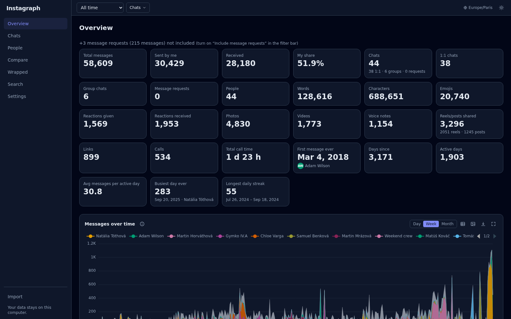
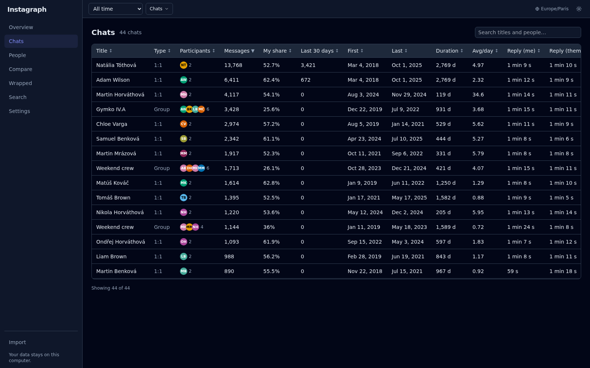
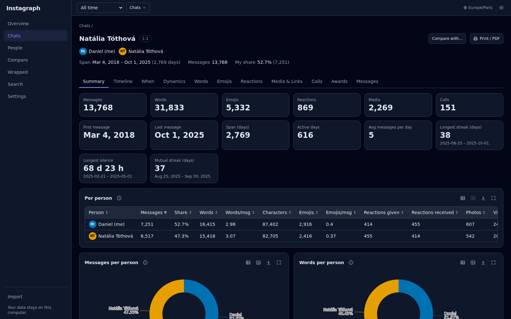
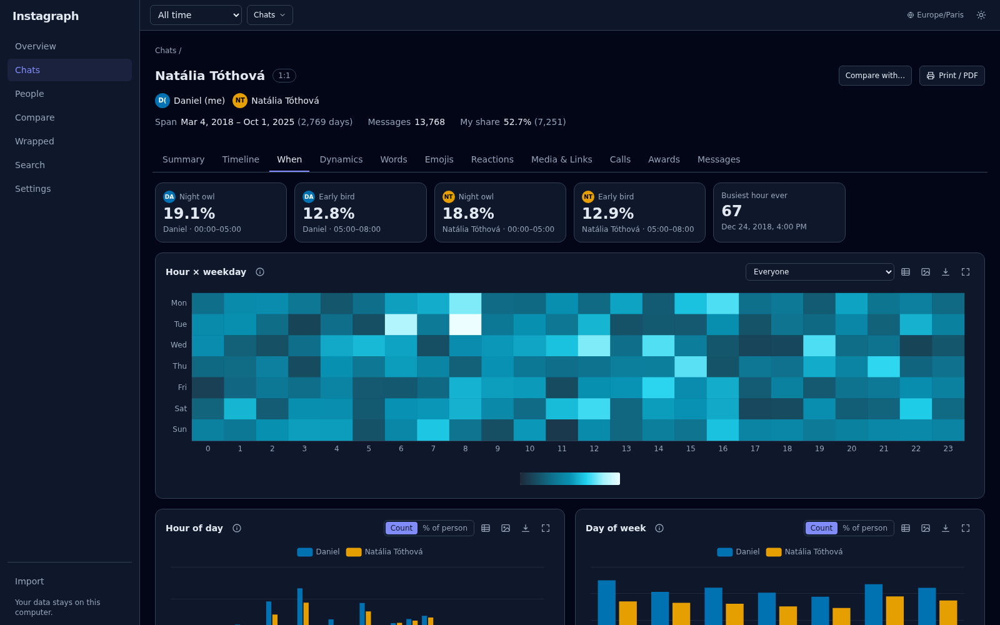
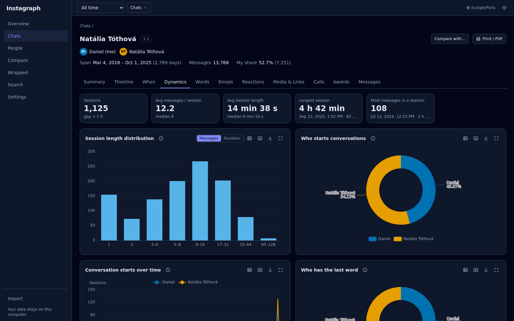
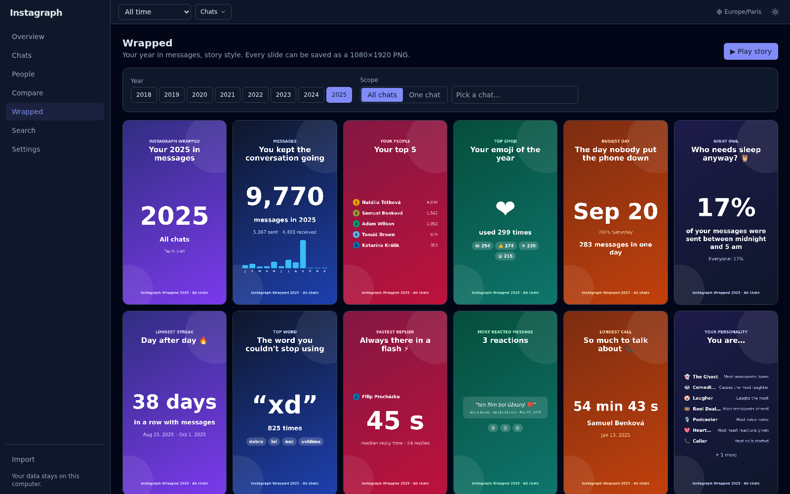

<div align="center">

# Instagraph

**Turn your Instagram message history into detailed statistics and interactive charts. Everything runs on your own computer.**


[](LICENSE)



</div>

Instagraph reads the **"Download Your Information"** export from Instagram (JSON format) and
analyses every direct message: who you talk to, when, how fast you reply, which words and
emojis you use, and how each chat changed over the years. It covers all chats together, each
chat on its own, and each person in it.

> **Private by design.** The backend listens on `127.0.0.1` only, makes no outbound network
> requests, and the frontend loads no third-party resources. There is no analytics.
> Your messages never leave your computer.

*Screenshots show the built-in sample data (fake people and messages).*

---

## Features

- **Overview dashboard:** totals, sent vs. received, top contacts, activity over time,
  emojis, reactions, media, calls, streaks and busiest days across all chats.
- **Chat explorer:** a sortable, searchable table of every chat, with reply times, trends
  (rising / fading) and activity sparklines.
- **Chat detail** with 12 tabs: Summary, Timeline, When, Dynamics, Words, Emojis, Reactions,
  Media & Links, Calls, Group, Awards and Messages.
- **Conversation dynamics:** who starts conversations, who replies faster, who double-texts,
  who has the last word, session lengths and unanswered messages.
- **Text analysis:** top words and phrases per person, a term tracker for any word over
  time, emoji usage and laughter patterns. Stop-word lists for English, Slovak and Czech.
- **People and Compare:** stats for each person across all shared chats, and 2 to 4 chats
  or people side by side.
- **Wrapped:** a story-style yearly recap, for all chats or a single one. Every slide can
  be saved as a 1080×1920 PNG.
- **Message browser:** full-text search (plain, whole word, regex, accent-insensitive),
  "on this day", and a jump into the conversation around any message. Click any number in
  the app to see the messages behind it.
- **Export:** every chart as PNG, every table as CSV, plus a print / PDF report of a chat.
- **Correct data:** fixes Instagram's broken text encoding (mojibake), detects system
  messages in several languages, and handles renamed users, deleted accounts and
  multi-file threads.
- **Fast on large exports:** built for 1,000+ chats and 2,000,000+ messages
  (Polars + Parquet).
- **Anonymize mode:** replaces all names with "Person A/B/C…" for safe screenshots.
- Light and dark theme, keyboard accessible, and every chart can be shown as a table.

## Screenshots

<table>
  <tr>
    <td width="50%"><br><sub><b>Chats</b>: every conversation, sortable and searchable</sub></td>
    <td width="50%"><br><sub><b>Chat summary</b>: headline numbers and per-person breakdown</sub></td>
  </tr>
  <tr>
    <td width="50%"><br><sub><b>When</b>: hour × weekday heatmap, night owls and early birds</sub></td>
    <td width="50%"><br><sub><b>Dynamics</b>: sessions, who starts and who ends conversations</sub></td>
  </tr>
  <tr>
    <td colspan="2"><br><sub><b>Wrapped</b>: your year in messages, story style</sub></td>
  </tr>
</table>

---

## Getting started

### Requirements

- **Python 3.12+**
- **Node.js 20.19+** and npm
- `make` and `bash` (Linux, macOS, or WSL on Windows)

### Install

```bash
git clone https://github.com/danoo-C/instagraph
cd instagraph
make setup      # creates backend/.venv, installs Python and npm dependencies
```

### Run

```bash
./launch
```

Open **<http://127.0.0.1:8000>**. `./launch` rebuilds the frontend first if anything changed
since the last build, then starts the server.

| Command | What it does |
| --- | --- |
| `./launch` | Serve on this computer only (`127.0.0.1:8000`) |
| `./launch --lan` | Also serve on your local network, e.g. to open it on your phone. Prints the URLs to use |
| `./launch --port 9000` | Use another port (`PORT=9000 ./launch` works too) |
| `./launch --rebuild` | Force a frontend rebuild |

> [!WARNING]
> With `--lan`, anyone on your network who can reach your computer can open the app and read
> your messages. Only use it on networks you trust.

> [!NOTE]
> **WSL users:** in the default NAT networking mode, other devices can't reach WSL. For
> `--lan`, set `networkingMode=mirrored` in `%UserProfile%\.wslconfig`, run `wsl --shutdown`,
> and allow the port in Windows Firewall.

### Get your Instagram export

1. Open Instagram, then **Settings → Accounts Center → Your information and permissions →
   Download your information**.
2. Choose **Messages** (or everything).
3. Set **Format: JSON** (not HTML), and **Date range: All time**.
4. When Instagram emails you, download the zip file(s).

In Instagraph, open **Import** and either drag in the zip file(s) or enter the path to the
zip or unpacked folder on disk. To try the app first, click **Load sample data** to generate
a fake dataset.

---

## Your data

- Imported data is stored in `data/` (set `INSTAGRAPH_DATA_DIR` to change it) and is kept
  between restarts.
- `data/` is git-ignored twice: in the root `.gitignore`, and by its own `.gitignore`
  containing `*`. Export zips and unpacked export folders are ignored too, so private
  messages can't be committed by accident.
- **Settings → Clear all data** deletes everything Instagraph stored.

## Configuration

Environment variables (or a `.env` file in `backend/`):

| Variable | Default | Description |
| --- | --- | --- |
| `INSTAGRAPH_DATA_DIR` | `<repo>/data` | Where imported data is stored |
| `INSTAGRAPH_HOST` | `127.0.0.1` | Bind address (a warning is logged for anything else) |
| `INSTAGRAPH_PORT` | `8000` | Port |
| `INSTAGRAPH_WORKERS` | CPU count − 1 | Number of processes used to parse the export |
| `INSTAGRAPH_ALLOWED_HOSTS` | (empty) | Extra hostnames accepted in the `Host` header (`./launch --lan` sets this) |
| `INSTAGRAPH_CORS_ORIGINS` | `http://localhost:5173` | Allowed CORS origins (dev server only) |

Analysis options such as time zone, session gap, reply window, stop words, merging people
and anonymize mode are in the app's **Settings** page.

---

## Development

```bash
make dev        # backend on :8000 + Vite dev server on :5173, both with hot reload
```

| Command | What it does |
| --- | --- |
| `make test` | Backend (pytest) and frontend (Vitest) tests |
| `make e2e` | Browser end-to-end test with Playwright (needs Chromium) |
| `make lint` | Ruff + mypy `--strict`, ESLint + TypeScript |
| `make format` | Auto-format the backend |
| `make gen-types` | Regenerate the frontend API types from the FastAPI OpenAPI schema |

API docs are available at <http://127.0.0.1:8000/docs> while the server runs.

### Project structure

```
instagraph/
├── launch              # build-if-needed + run script
├── Makefile            # setup, dev, build, test, lint, gen-types
├── spec.md             # full specification
├── backend/            # Python 3.12, FastAPI, Polars, Parquet
│   └── src/instagraph/
│       ├── importer/   # export discovery, parsing, encoding fixes, system messages
│       ├── analysis/   # one module per metric family
│       ├── api/        # REST routes
│       ├── schemas/    # Pydantic request/response models
│       ├── store/      # Parquet dataset + caching
│       └── sample/     # fake data generator
└── frontend/           # React 18, TypeScript, Vite, ECharts, Tailwind
    └── src/
        ├── pages/      # Overview, Chats, ChatDetail, People, Compare, Wrapped, …
        ├── charts/     # ECharts wrappers with PNG/CSV export
        └── api/        # typed API client (generated from OpenAPI)
```

Further reading: [`spec.md`](spec.md) (full specification and metric definitions),
[`backend/CONTRACTS.md`](backend/CONTRACTS.md) and
[`frontend/CONTRACTS.md`](frontend/CONTRACTS.md) (interfaces for contributors).

## License

Released under the [MIT License](LICENSE).

## Disclaimer

Instagraph is an independent project. It is not affiliated with, endorsed by, or
connected to Instagram or Meta. It only reads the export file you download yourself, and
never logs in to or talks to Instagram.
